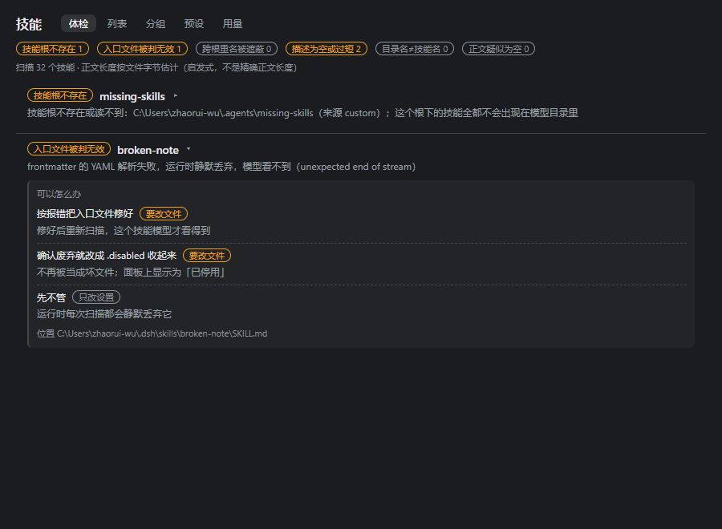
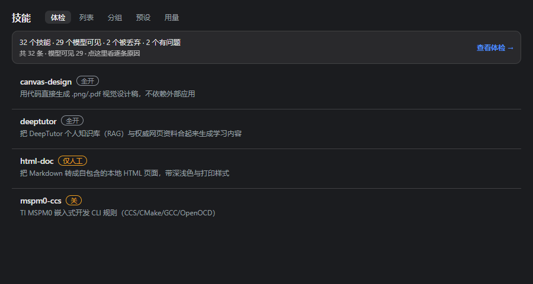

# dsh-skill-cockpit

> **状态：v0.6.8 —— 已在真机端到端跑通。** **6/6 套件 · 287 断言**全绿，CI 每次推送都跑同一套。已以 `dsh-skill-cockpit` 发布，**npm 上现在是 0.2.3**，本版 0.6.7 是下一次发布。（裸名 `dsh-skill-panel` 属另一位作者。）截图正按 0.6.7 重拍，见 [截图](#截图)。

DSH（DeepSeek Harness）**技能面板**：在**左上应用级导航排**加一个「技能」入口，
点开是**主区一整页**，列出本机**全部**技能、**按技能开关**，并接「未安装技能索引」做第二跳。

- 挂载点 = **官方 `slots` 扩展点**的两个座位（不再走第三方 `dsh-better-sidebar`）：
  1. `sidebar.panellist`（root 作用域的 **list**，即左上应用级导航排）→ 图标行，`order: 5`；
  2. `main`（root 作用域的 **keyed**）→ 主区整页，`key` 与行 `id` 同名（`skill-panel`）。
- **顺序严格夹在「插件」(order 0) 与「自动化任务」(order 10) 之间** —— 外壳按 `order` 升序排（`sort((a,b)=>a.order-b.order)`），5 落在唯一的空档里，与加载先后无关。
- 因此本包**不声明任何 `@deepseek-ai/dsh*` peer** ⇒ 不受 DSH 兼容性豁免闸门影响（见工作区 `AGENTS.md` §四 铁律 1/3）
- 纯 ESM JavaScript，无构建链：`lib/*.js` 直接可跑，自测用 `node` 即可复跑

## 它解决什么

`~/.dsh/skills` 只是**六类技能根**中的一类。只扫它 → 面板少报技能（本机实测 31 vs 会话可见 39）。
更要紧的是：**frontmatter 写坏 = 运行期静默丢弃**（`dsh-skill-filesystem` 解析失败即 `continue`），
用户看到的是"这个技能不存在"，而不是"这个技能写坏了"。

本面板：

| 能力 | 说明 |
|---|---|
| 六类根全枚举 | `project-dsh(100)` / `project-agents(200)` / `custom(300)` / `user-dsh(400)` / `user-agents(500)` / `bundled(600)`，各带 `source` + `rank` |
| 坏 frontmatter 显式报错 | `dropped:no-frontmatter` / `dropped:unclosed` / `dropped:bad-yaml` / `dropped:missing-fields` / `dropped:bad-name`，每条带原因；**"丢了"就显示"丢了"** |
| 根不存在也算一种状态 | 显示"不存在（正常）"；`bundled` 未挂载时显示 `$DSH_BUNDLED_SKILL_DIR` 未设置，而不是假装有 |
| 每技能开关 | 唯一写盘动作 = **改入口文件名**：`SKILL.md ↔ SKILL.md.disabled`（扁平型 `x.md ↔ x.md.disabled`） |
| 会话作用域 | 面板顶部显示"当前会话 cwd / 项目根"；项目级根**只读**（写工作区 = 绕过"工作区=权限域"边界） |
| 第二跳 | 命中「未安装技能索引」时给信息卡 + 复制按钮，**不下载、不安装** |

## 四个页面

面板是导航里的一页，顶部四个视图：

| 视图 | 干什么 |
|---|---|
| **列表** | 全部技能一处看：名字、来源根标签、功能标签、描述、体积、单技能开关、「看正文」读入口文件 |
| **分组** | 自己摆的看板 —— 从左侧把卡片拖进右边某个组；六个内置功能分组（文档办公 · 代码工程 · 设计视觉 · 写作沟通 · 研究资料 · 元技能）+ 自建组，可改名、可删 |
| **用量** | 从会话日志聚合每个技能的调用次数，看清哪些装了从没用过 |
| **问题** | 「能加载但白占坑」与「某技能为何不在」的诊断，一条一行 |

两个**必须写明的行为**，因为这两处正是同类面板容易撒谎的地方：

- **组头是一个三态开关。** 全亮 = 整组启用，全灭 = 整组停用，半亮 = 混合。点它逐条改入口文件名；整组停用时整块变灰，不用去读「启用 0」那行字。
- **分组与归属存在本浏览器（`localStorage`），不落盘。** 摆看板不写任何文件；整个插件唯一的写盘动作仍是入口文件改名。
## 状态即文件名（无第二份状态）

开关状态**每次扫描都从文件名重新读出**，插件里没有 prefs、没有数据库、没有内存副本。
所以面板不可能出现"显示已关、模型照样能加载"的假开关。
（对照：better-sidebar 自带的 `pluginSettings` 管的是"这个 tab 显不显示"，**不是**技能开关。）

## 截图

深色主题、真实 CSS 渲染（900px 宽）：




## 装配

```bash
npm install dsh-skill-cockpit
```

（现在 npm 上是 **0.2.3**，0.6.7 待发。想直接跑当前源码，用下面的本地 link。）

```jsonc
// ~/.dsh/profiles/<profile>/package.json
"dependencies": { "dsh-skill-cockpit": "link:D:/插件/dsh-skill-panel" }
```

```yaml
# ~/.dsh/profiles/<profile>/cordis.patch.yml
- insert:
    - id: skill-panel
      name: 'dsh-skill-cockpit'
      # 可选配置（全部有默认值）：
      # config:
      #   dshHome: 'C:\\Users\\<你>\\.dsh'          # 默认 $DSH_HOME 或 ~/.dsh
      #   agentsHome: 'C:\\Users\\<你>\\.agents'     # 默认 $DSH_AGENTS_HOME 或 ~/.agents
      #   customSkillDirs: []                       # 额外的技能根
      #   bundledSkillDir: ''                       # 默认 $DSH_BUNDLED_SKILL_DIR
      #   includeDefaultRoots: true
      #   writableSources: ['user-dsh']             # 默认 ['user-dsh','user-agents']
      #   undeclaredIndexPath: 'D:\\管家\\技能索引与最小路由\\技能改造\\未安装技能索引-正文.md'
```

改装配 = **要重启 dsh**（进程红线：重启只由户主执行）。技能开关**不需要**重启。

## HTTP 路由（宿主半，本机同源）

| 方法 | 路径 | 作用 |
|---|---|---|
| GET | `/__dsh-skill-panel/ping` | 插件身份 + 路由清单 + 可写根 |
| GET | `/__dsh-skill-panel/skills?cwd=…` | 全量扫描报告（`cwd` 决定项目级根） |
| GET | `/__dsh-skill-panel/body?path=…&cwd=…` | 读一个入口文件正文（**白名单制**：只认 `/skills` 报告里出现过的入口，带体积上限） |
| GET | `/__dsh-skill-panel/undeclared?q=…` | 搜未安装技能索引（只读） |
| GET | `/__dsh-skill-panel/usage` | 技能调用次数：`{ ok, skills:[{name,count,lastAt}], scanned, skipped, sessions, updatedAt }` |
| GET | `/__dsh-skill-panel/checks?cwd=…` | 四类「能加载但白占坑」诊断：`{ ok, checks:[{kind,skill,detail}], summary, thresholds, note }` |
| POST | `/__dsh-skill-panel/toggle` | `{ filePath, disable, cwd, plan? }` → 改名（唯一写动作） |

`/usage` 只写一个文件：`<dshHome>/dsh-skill-cockpit/usage.json`，内容只有**技能名 / 调用次数 / 时间戳**
（不存任何对话内容）；扫描是增量的 —— 会话日志 `(size, mtime)` 没变就跳过，本机 104 个会话的第二次调用 21ms。
`/checks` 是纯计算（不读磁盘），阈值默认「描述 <20 字」「文件 <300 字节（按字节估计，含 frontmatter）」。

### 为什么有些技能禁不了

技能到会话有两条路，只有一条落在文件上：

- **文件型**（`user-dsh` / `user-agents` / `custom` / 项目根 / 内置目录）：入口是真 `SKILL.md` 或 `x.md`，
  面板改入口文件名即可停用。
- **非文件型（provider 提供）**：宿主的契约是 `ctx.skills.registerProvider(() => provider)`，**只做加法** ——
  provider 贡献自己的 `list()`，**没有任何钩子能包装 / 过滤 / 排除别人输出的技能**。面板对它无能为力。

这不是漏做，是宿主 API 的形状；所以面板如实标注：这类行在开关位置显示
「本面板无法禁用（属 … provider）」，**不画一个点了也不会有反应的假开关**。

`plan: true` 只算不动 → 面板用它做"确认改名"预告，自测也用它验 dry-run。

### 两条拒绝是所有权的边界（各有负向测试）

面板是本机 web 面，所以路由**不信调用方**：

- **`/body` 是白名单制**：只回答 `/skills` 报告里**列过**的入口文件。其它路径 —— 任意文件、插件自己的数据文件、
  仅仅"存在"的路径 —— 一律 **403 且不回传任何内容**。所以这条路由**不可能被当成任意文件读取器用**。
  （0.3.1 之前是"给什么读什么"，这条是复核时发现的，不是事故。）
- **`/toggle` 只在两个写根内落笔**：目标必须位于 `~/.dsh/skills` 或 `~/.agents/skills` 内；**项目级根只读，哪怕报告里列出了那个文件**
  （因为由会话 `cwd` 推出来的路径永远不该变成写操作）。

`cwd` 在两条路由上都是**可选的**（0.3.2 起）：这面板同时也是没有会话的全局页。没有 `cwd` 时报告里就没有项目级根，
于是**项目级入口被拒、用户级入口照常工作**；而解析不出来的 `cwd` 按"不存在"处理、不被信任，因此不可能绕过写根门。

其余写路由护栏（任一条不满足即拒绝并给中文原因）：目标必须存在、必须是普通文件（**永不改目录名**）、
必须直接位于可写根内（真实路径比对，防符号链接逃逸）、必须正好是入口文件（`<目录>/SKILL.md` 或 `<根>/x.md`）、
目标名不得已存在（防覆盖）；另有同源栅栏（带外部 `Origin` 的请求一律 403）。

## 后备库（reserve list）

- 默认名单：`<DSH home>/skill-panel/后备库.md`（首次「存进后备库」时自动创建）。
- 想用自己已有的清单：配置 `reserveListPath` 指向那个 markdown 文件（表格列：名字 / 一句话能力 / 来源 / 体积 / 备注）。
- 删除技能时勾「存进后备库」= 照常删进回收站 + 名单追加一行；「恢复」按「来源」下载（git 地址，需本机装 git）或复制（本机目录）。

## 后备技能库（可选）

技能不必「先装才能找」。在 `~/.dsh/skills` 与 `~/.agents/skills` 之外随便找个文件夹放那些
没装的技能目录，再在旁边写一份 markdown 表格 —— 那个文件夹 dsh 不扫描、不加载，既不占上下文也不占
内存，等于冷备：只有面板的搜索能看见它。

表格就是契约，一个技能一行，五列：

| 名字 | 一句话能力 | 来源（仓库·许可） | 体积 | 适用会话/预设 |
|---|---|---|---|---|
| `code-review` | 审查改动：正确性、安全、测试覆盖 | my-org/skills · MIT | 42.1 KB | 任意 |

把插件配置 `undeclaredIndexPath` 指向这份文件。之后搜索在已装列表里没命中时，会顺手查这张表，
渲染成只读卡片（名字 / 一句话能力 / 来源与许可 / 体积 / 建议会话）并给一个「复制」按钮 ——
面板自己**不下载、不安装**。

真要用了再「临时装」：点「导入技能」，填备用库里那个目录的路径，面板把它拷进可写根；任务做完删掉，
删除先进回收站，随时能还原，备用库原件不动。

不配、或配了但文件不存在，第二跳直接不出现，不报错。（默认值指的是作者本机那份清单，请改成你自己的。）

## 自测

```bash
node test/run-all.mjs [报告目录]
```

六个套件（全部不需要 GUI / 不需要 dsh）：

| 套件 | 覆盖 |
|---|---|
| `run-data-layer.mjs` | 六类根 / `dropped:*` 全可达（合成 fixture）/ `root-missing` / **独立目录遍历比对（不多报、不漏报）** / 字节数与磁盘一致 |
| `run-toggle.mjs` | 在**真实** `~/.dsh/skills` 上对 1 个新建探针做 改名→停用→改回 闭环：sha256 一致、根项数不变、面板仍显示"已停用"、清理后零残留；另含目录/非入口/根外/项目级四类拒绝路径 |
| `run-routes.mjs` | 假 ctx 跑真 `apply()`：**7 条路由**注册、200/400/403/405、ping、`/usage` 落盘到**配置的**路径（自测绝不写真实 `~/.dsh`）且第二次增量跳过、`/checks` 真实命中 |
| `run-client.mjs` | 假 `__ModuleLoader__` + React 桩：bundle 求值、**挂载对（`sidebar.panellist` 行 id/order/label + `main` keyed 页 key 一致）**、`order=5` 夹位断言、**座位未声明时不注册也不抛错**、健康/坏 frontmatter/第二跳/错误态/**无 `useSessions` 降级**、**三个视图（列表/用量/问题）**、用量空态那句、非文件型的「禁不了」标注、主题令牌无死令牌 |
| `run-usage.mjs` | 真 zstd **多帧**文件（每帧独立压缩再拼接）：多帧解码 / 单帧 / 纯文本回退 / 垃圾字节 / `seq` 去重 / 深层嵌套事件筛选 / 增量跳过 / 文件变大不双计 / 落盘结构 / **隐私（落盘不含对话原文）** |
| `run-checks.mjs` | 四类诊断各自正反例：`shadowed` / `short-description`（空、19 字、正好 20 字）/ `dir-name-mismatch`（仅 `dir-bundle`）/ `empty-body`（阈值边界）/ 汇总 / 阈值覆盖 / 畸形输入不抛 / 纯函数不改入参 |

## 边界（有意不做）

- 项目级根**不写**（安全边界：工作区 = 权限域）
- 不安装、不下载、不删除任何技能；停用只改名，文件内容一字节不动
- 不做"最近被加载"（要动宿主埋点，成本大于收益）
- 不保留任何"面板侧开关状态"（技能开关 = 文件名，见上）

## 未实查项（如实标注）

- `bundledSkillDir` 的实际取值：本机 `$DSH_BUNDLED_SKILL_DIR` 未设置、profile patch 里也没有该配置项
  ⇒ 本插件按"未挂载"如实显示。会话可见 39 条 vs `~/.dsh/skills` 31 条的差额来源**仍未定位**
  （`app.asar` 内未见 `reviewer-response` 之类的技能文件；`E:\DSH\resources` 下也无）。面板不会替它猜。
- `@deepseek-ai/dsh-client-*` 原生 Slot 树（设计方案的 H4）**已实查**：本次改挂载面时从**运行中的 `E:\DSH\resources\app.asar`**（0.2.0-rc.2）字节扫描确认 `sidebar.panellist` / `main` 两个座位、`order` 升序语义、以及各占用方（`client-ui-plugin-manager` 0 / `client-ui-schedule` 10 / task-board 20 / ssh 40）。
- 生态惯例与户主指定顺序**不一致**（已如实上报）：`dsh-ssh` 源码注释把 0/10/20/30/40 记为「Plugins / Schedule / board / **skill center 30**」，即生态预留 30 给"技能中心"；本包按户主明确要求取 **5**（夹在 插件 0 与 自动化任务 10 之间）。要改回 30 只需改 `lib/client.js` 的 `PANEL_ORDER` 一个数字。
- 重启后**真实 GUI 渲染**（左排出现「技能」、点击开整页、右侧栏不再出现）**尚未经人眼确认** —— `lib/client.js` 是启动时载入的，必须由户主重启 dsh 才装载。

## 许可

MIT。
